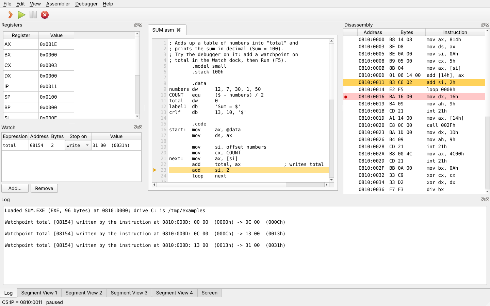
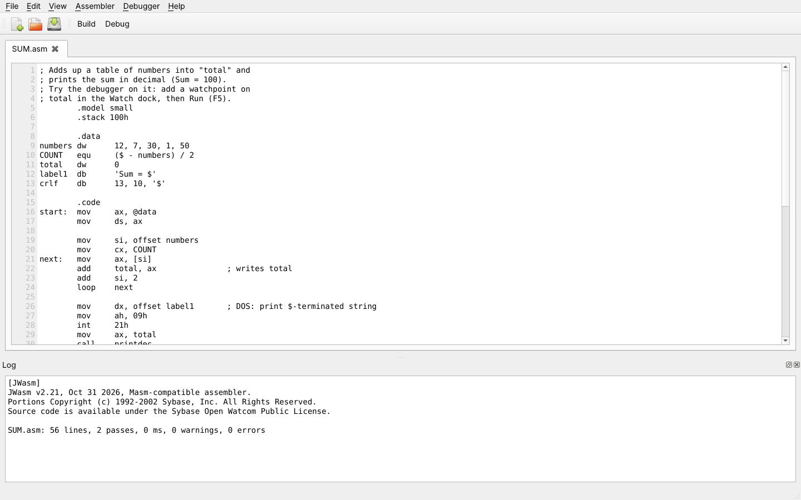
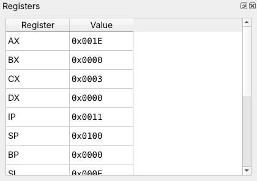
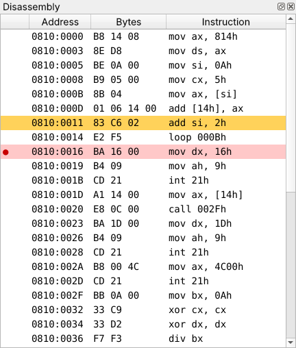
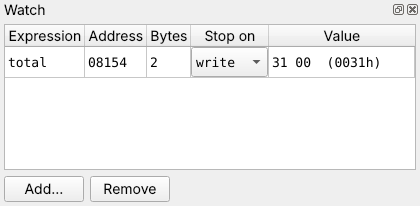
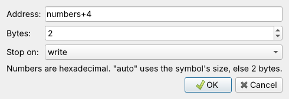
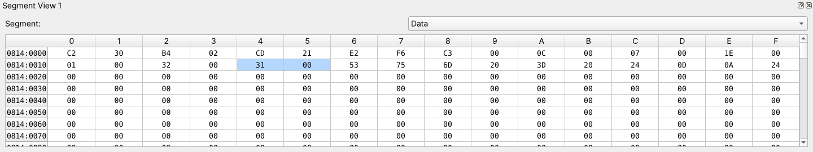
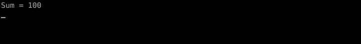

# Tinker86

A desktop IDE for writing, assembling and debugging Intel 8086 assembly programs.
Write a program, build it into a DOS `.EXE` with one key, then run it on an emulated
IBM PC and step through it while you watch the source, registers, memory,
disassembly and text screen. (Formerly called 8086 Simulator.)



- **Runs anywhere**: portable builds for Windows, macOS and Linux, with the JWasm
  assembler included. Nothing to install.
- **Source-level debugger**: step, run, pause, run to cursor, breakpoints in the
  source or the disassembly, and the current line highlighted in your code.
- **Data watchpoints**: stop when an instruction writes, reads or touches a variable,
  and see which instruction did it with the old and new values.
- **A real 8086**: the full instruction set, checked against 3,064,000 test vectors
  captured from real hardware.
- **DOS and BIOS**: text screen, keyboard, files and folders through `INT 10h`,
  `INT 16h`, `INT 21h` and more, so ordinary DOS course programs run unchanged.
- **Two assemblers**: JWasm (built in, MASM syntax) or Borland TASM/TLINK in DOSBox.

📖 **[User guide](docs/USER_GUIDE.md)** ([PDF](docs/USER_GUIDE.pdf)): installing, a
first program, every part of the window, the debugger, the emulated PC and
troubleshooting. The guide is also included in every release download.

## Download

Get the portable app for your system from the
[Releases page](https://github.com/Gagandheep/Tinker86/releases):

| System | Download |
|---|---|
| Windows 10/11 (x64) | `Tinker86-<version>-windows-x64.zip` |
| macOS, Apple silicon | `Tinker86-<version>-macos-arm64.zip` |
| macOS, Intel | `Tinker86-<version>-macos-x64.zip` |
| Linux x64 (Ubuntu 22.04, Debian 12, Fedora 36 or later) | `Tinker86-<version>-linux-x64.tar.gz` |

Unpack it and start `Tinker86` inside. The apps are not code-signed: on macOS,
right-click the app and choose **Open** the first time; on Windows, SmartScreen may
ask you to confirm under **More info**.

## A quick tour

**1. Write and build.** Open `examples/sum.asm` and press **F7**. The assembler's
output appears in the Log.



**2. Debug.** Press **F8** to load the program. The line about to run is highlighted
in the source and in the Disassembly. Press **F10** to step one instruction, **F5** to
run, **F4** to run to the cursor, and click the editor gutter (or press **F9**) for a
breakpoint.

<p>
  
  
</p>

**3. Watch your data.** Add a watchpoint on a variable (`total`, `DS:0010`,
`ES:DI+2`...) and Run: execution stops right after the instruction that changed it.
Watched bytes are marked in the memory views, where you can also edit memory and
right-click to watch a byte or word.

<p>
  
  
</p>



**4. See the output.** Text the program prints appears on the emulated 80×25 colour
Screen. When the program waits for a key, click the Screen and type.



The [user guide](docs/USER_GUIDE.md) explains each of these in detail.

## Running from source

Needs Python 3.8+ and PyQt5.

```sh
pip install -r requirements.txt
tools/build_jwasm.sh       # builds JWasm into external/jwasm/ (needs git, make, gcc)
python main.py
```

Instead of building JWasm you can put `jwasm` (or `uasm`) on `PATH` or set `JWASM` to
its executable; on Windows, download `jwasm.exe` from the
[JWasm releases](https://github.com/Baron-von-Riedesel/JWasm/releases).

**TASM (optional).** To build with Borland Turbo Assembler and Turbo Link instead,
install [DOSBox](https://www.dosbox.com/) (on `PATH`, or set `DOSBOX`) and copy the
contents of a Turbo Assembler `BIN` folder (with `TASM.EXE` and `TLINK.EXE`) into
`external/tasm/BIN/`, or set `TASM_DIR` to a Turbo Assembler folder. TASM is not
included in this repository. Tested with TASM 4.1 and TLINK 7.1. **Assembler →
Automatic** uses TASM when it is installed, otherwise JWasm; the Assembler menu or the
`ASSEMBLER` environment variable (`tasm`, `jwasm`, `auto`) picks one explicitly.

The emulator also works without the UI:

```python
from Microprocessor import Microprocessor
from Microprocessor.dos import DOS

cpu = Microprocessor()
dos = DOS(cpu, output=print, root='.')         # drive C: is the current directory
dos.bios.keyboard.push_text('typed input\r')   # keys for programs that read the keyboard
cpu.load_program('HELLO.EXE')
cpu.run()          # returns early when the program waits for more keys
print('exit code', cpu.exit_code)
print(dos.bios.screen_text())
```

## What is emulated

- **CPU**: the complete 8086 instruction set, including segment-override, `REP` and
  `LOCK` prefixes, interrupts and the single-step trap. Undocumented opcodes behave
  like a real 8088. Clock timing is not emulated.
- **Programs**: DOS `.EXE` (MZ, with relocations and a PSP) and `.COM` files.
- **BIOS**: 80×25 colour text screen at `B800:0000`, `INT 10h` video (00h–03h,
  05h–0Ah, 0Eh, 0Fh, 13h), `INT 16h` keyboard (00h–02h, 10h–12h), `INT 11h`, `INT 12h`
  and `INT 1Ah` (ticks, RTC time and date).
- **DOS**: `INT 20h` and `INT 21h` console I/O (01h, 02h, 06h–0Ch), files (3Ch–43h,
  44h/00h, 56h), folders (39h–3Bh, 47h, 4Eh/4Fh with the DTA), drives, memory
  (48h–4Ah), interrupt vectors, date/time, version and exit. Drive C: is the program's
  folder.

Not emulated: graphics modes, hardware interrupts and I/O ports, the 8087, and DOS
functions such as running other programs. See
[Known limitations](docs/USER_GUIDE.md#13-known-limitations) for the full list.

## Development

```sh
python -m unittest discover tests     # unit, loader, assembler and UI tests (UI tests run offscreen)
tests/fetch_sst.sh                    # download the SingleStepTests 8088 suite once (~1.5 GB on disk)
python tests/sst_runner.py            # 300 vectors per documented opcode
python tests/sst_runner.py --all-statuses --limit 0   # every vector, incl. undocumented opcodes
SST_TESTS=1 python -m unittest tests.test_disassembler  # disassembler vs. the vector names
```

`tests/test_real_build.py` assembles `examples/hello.asm` with the real assemblers and
follows it in the source; each case is skipped when its toolchain is missing.
`tests/fixtures` holds real TASM 4.1/TLINK 7.1 and JWasm output for the tests that do
not need the tools. [SingleStepTests/8088](https://github.com/SingleStepTests/8088)
holds test vectors captured from a real 8088 (same instruction set as the 8086); the
emulator passes all 3,064,000 of them, not comparing flags the ISA leaves undefined.

**Packaging.** `pip install pyinstaller -r requirements.txt`, `tools/build_jwasm.sh`,
then `python tools/package.py --test` builds and self-tests the portable app for the
current system. Running the Release workflow from the Actions tab with a tag such as
`v1.1.0` (or pushing that tag) builds, tests and publishes all four builds.

**Docs.** `docs/USER_GUIDE.md` is the source of the guide. After editing it, run
`python tools/build_guide_pdf.py` (needs pandoc and Playwright with Chromium) to
regenerate the PDF. `xvfb-run -a -s "-screen 0 1600x1000x24" python
tools/screenshots.py` retakes the screenshots in `docs/images/` from the real app.

| Path | Contents |
|---|---|
| `main.py` | Application entry point |
| `Microprocessor/` | CPU core, disassembler, `.EXE`/`.COM` loader, BIOS, DOS, watchpoints |
| `Assembler/` | Building with JWasm or TASM/TLINK, listing and map parsing for the source view |
| `UI/` | PyQt5 main window |
| `examples/` | Example programs |
| `docs/` | User guide (Markdown and PDF) and screenshots |
| `tools/` | JWasm build, packaging, screenshot and PDF scripts |
| `tests/` | Unit tests and the SingleStepTests runner |
| `external/tasm/BIN/` | DOSBox settings for TASM builds; put `TASM.EXE` and `TLINK.EXE` here |
| `.github/workflows/release.yml` | Builds, tests and publishes the portable apps |
