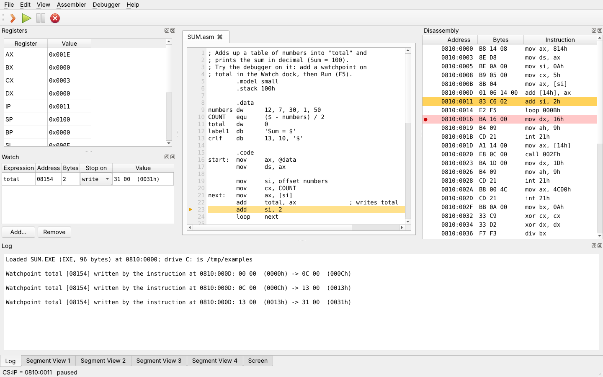
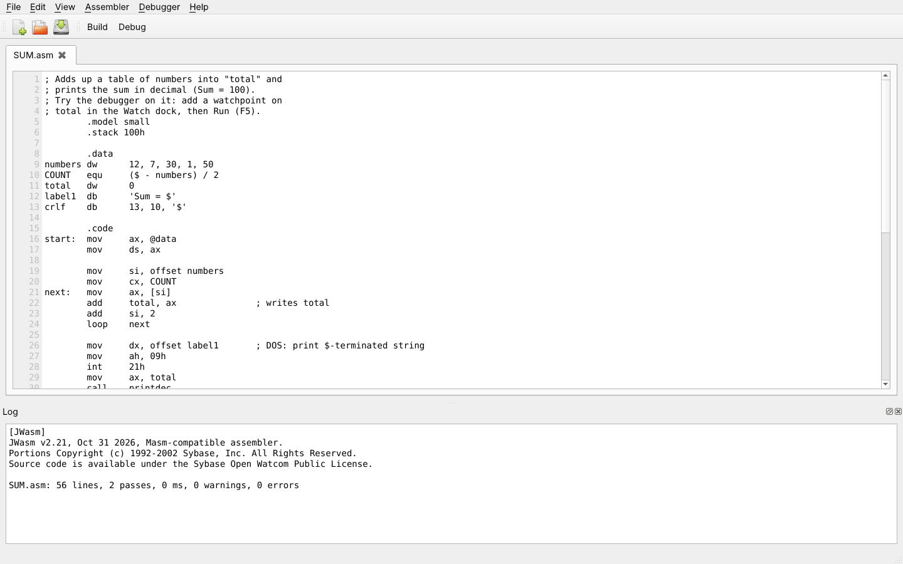
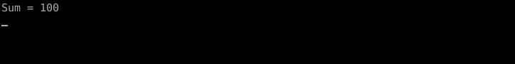
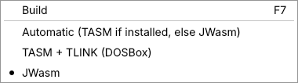
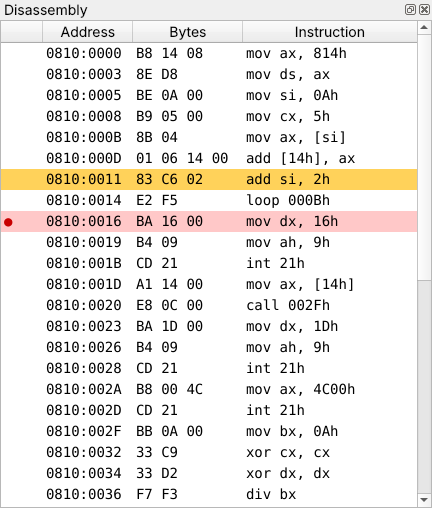
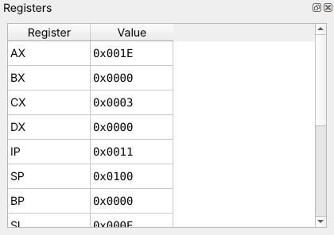
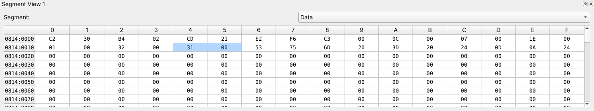
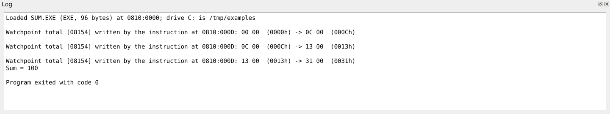
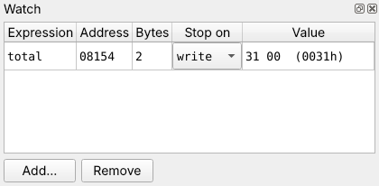
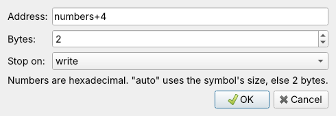

# 8086 Simulator User Guide

The 8086 Simulator is a desktop IDE for learning and experimenting with Intel 8086
assembly language. You write a program in the editor, assemble it into a DOS `.EXE`
with one key, and then run it on an emulated IBM PC while you watch the registers,
memory, disassembly and text screen change one instruction at a time.

This guide covers installing the app, a first walk through a complete program, every
part of the window, the debugger, the emulated PC and its DOS and BIOS services, and
answers to common problems.



**Contents**

1. [Installing](#1-installing)
2. [Your first program in five minutes](#2-your-first-program-in-five-minutes)
3. [The main window](#3-the-main-window)
4. [Writing programs](#4-writing-programs)
5. [Building](#5-building)
6. [Debugging](#6-debugging)
7. [Watchpoints](#7-watchpoints)
8. [The screen and the keyboard](#8-the-screen-and-the-keyboard)
9. [The emulated PC](#9-the-emulated-pc)
10. [Keyboard shortcuts](#10-keyboard-shortcuts)
11. [Using the emulator from Python](#11-using-the-emulator-from-python)
12. [Troubleshooting](#12-troubleshooting)
13. [Known limitations](#13-known-limitations)

---

## 1. Installing

### 1.1 Portable app (recommended)

Download the archive for your system from the
[Releases page](https://github.com/Gagandheep/8086-Simulator/releases):

| System | File |
|---|---|
| Windows 10/11 (x64) | `8086-Simulator-<version>-windows-x64.zip` |
| macOS on Apple silicon (M1 and later) | `8086-Simulator-<version>-macos-arm64.zip` |
| macOS on Intel | `8086-Simulator-<version>-macos-x64.zip` |
| Linux x64 (glibc 2.35+, e.g. Ubuntu 22.04, Debian 12, Fedora 36 or later) | `8086-Simulator-<version>-linux-x64.tar.gz` |

Unpack it anywhere (your home folder, a USB stick) and start the app inside the
`8086-Simulator` folder. Nothing is installed and nothing outside the folder is changed.

| System | Start |
|---|---|
| Windows | double-click `8086-Simulator.exe` |
| macOS | double-click `8086-Simulator.app` |
| Linux | `./8086-Simulator` (or double-click it in your file manager) |

The JWasm assembler is included, so building and debugging work straight away. The
folder also contains `examples/` with ready-to-run programs, `docs/` with this guide,
and `README.txt`.

**First start on macOS.** The app is not signed by Apple, so macOS refuses to open it
on a double-click. Right-click (or Control-click) `8086-Simulator.app`, choose
**Open**, then **Open** again. You only need to do this once. If macOS says the app
"is damaged", open Terminal in the unpacked folder and run:

```sh
xattr -dr com.apple.quarantine 8086-Simulator.app
```

**First start on Windows.** SmartScreen may warn about an unknown publisher. Choose
**More info**, then **Run anyway**.

**Linux.** The app needs a desktop session with X11 or XWayland.

### 1.2 Running from source

You need Python 3.8 or newer.

```sh
git clone https://github.com/Gagandheep/8086-Simulator.git
cd 8086-Simulator
pip install -r requirements.txt     # PyQt5
tools/build_jwasm.sh                # downloads and builds JWasm into external/jwasm/ (needs git, make, gcc)
python main.py
```

Instead of building JWasm you can put `jwasm` (or `uasm`) on your `PATH`, or set the
`JWASM` environment variable to its executable. On Windows, download `jwasm.exe` from
the [JWasm releases](https://github.com/Baron-von-Riedesel/JWasm/releases).

### 1.3 Optional: Turbo Assembler (TASM)

JWasm understands MASM syntax, which is what most course material and TASM programs
use. If your programs need TASM itself (for example TASM's Ideal mode), the app can
run Borland Turbo Assembler and Turbo Link inside DOSBox:

1. Install [DOSBox](https://www.dosbox.com/). It must be on your `PATH`, or set the
   `DOSBOX` environment variable to the DOSBox executable. On macOS the app also
   finds `/Applications/dosbox.app`.
2. TASM is not included with the app. Copy a Turbo Assembler folder whose `BIN` folder
   contains `TASM.EXE` and `TLINK.EXE` (plus the files they need, such as `RTM.EXE`
   and `DPMI16BI.OVL`):
   - portable app: into a folder named `tasm` next to the app, so the app finds
     `tasm/BIN/TASM.EXE`;
   - from source: into `external/tasm/BIN/`;
   - anywhere else: set `TASM_DIR` to the Turbo Assembler folder.
3. Choose **Assembler → TASM + TLINK (DOSBox)**, or leave **Automatic**, which uses
   TASM whenever it is fully installed.

The app is tested with TASM 4.1 and TLINK 7.1. DOSBox runs hidden while it builds; you
do not see a DOSBox window.

---

## 2. Your first program in five minutes

This walk-through uses `examples/sum.asm`, which adds up a table of numbers into a
variable called `total` and prints `Sum = 100`.

1. **Open the program.** Choose **File → Open...** (Ctrl+O) and pick
   `examples/sum.asm`. If you started from source, the file is in the repository's
   `examples` folder; in the portable app it is in the `examples` folder next to the app.

2. **Build it.** Press **F7** (or **Build** on the toolbar). The file is saved, the
   assembler runs, and its messages appear in the **Log** at the bottom. A successful
   JWasm build ends with `0 warnings, 0 errors`.

   

3. **Start debugging.** Press **F8** (**Debug**). The program is loaded at its entry
   point and the window switches to debug mode: the **Registers** and **Watch** docks
   open on the left, the **Disassembly** on the right, and the **Screen** and memory
   views join the Log at the bottom. The editor becomes read-only and an orange arrow
   in its gutter marks the line about to run.

4. **Step.** Press **F10** a few times. Each press runs one instruction. Watch `AX`
   and `DS` change in the Registers dock after `mov ax, @data` and `mov ds, ax`.

5. **Add a watchpoint.** Click **Add...** in the Watch dock, type `total` and press OK.
   The debugger will now stop every time an instruction writes to `total`.

6. **Run.** Press **F5**. The program runs until the loop writes `total`; the Log says
   which instruction wrote it and shows the old and new values, for example
   `00 00 (0000h) -> 0C 00 (000Ch)`. Press F5 again to stop at the next write.

7. **Set a breakpoint.** Click in the gutter (left of the line numbers) next to
   `mov dx, offset label1`, the line after the loop. A red dot appears. Remove the
   watchpoint (select it, **Remove**) and press F5: the program finishes the loop and
   stops at the breakpoint.

8. **Finish.** Press F5 once more. Open the **Screen** tab at the bottom to see the
   output, `Sum = 100`. The Log ends with `Program exited with code 0`.

   

9. **Leave debug mode** with **Debugger → Exit Debug** (the red stop button). You can
   edit the source again; press F7 to rebuild and F8 to debug the new version.

---

## 3. The main window

### 3.1 Editing mode

When you are not debugging, the window shows the editor with one tab per open file,
the file and build toolbar, and the Log.

- **Tabs.** Each open file has a tab. A `*` after the name means unsaved changes.
  Tabs can be dragged to reorder them and closed with their close button or Ctrl+W;
  you are asked before unsaved changes are lost.
- **Editor.** A plain-text editor with line numbers and no line wrapping, so each
  source line stays on one row. Undo, redo, cut, copy, paste and select all are in the
  **Edit** menu and have the usual shortcuts.
- **Log.** Shows the assembler's output after a build, and the program's DOS console
  output and debugger messages while debugging.

### 3.2 Debug mode

**Debug** (F8) switches to debug mode, shown at the top of this guide. Building is not
possible in debug mode; the toolbar shows the debugger controls instead:

| Button | Action | Key |
|---|---|---|
| Step | Run one instruction | F10 |
| Run | Run until a breakpoint, a watchpoint, a key is needed, or the program ends | F5 |
| Pause | Stop a running program | Shift+F5 |
| Exit Debug | Leave debug mode and return to editing | |

The **Debugger** menu also has **Run to Cursor** (F4), **Toggle Breakpoint** (F9),
**Clear Breakpoints** and **Add Watchpoint...** (Ctrl+Shift+W).

The status bar at the bottom shows `CS:IP` and the state: *paused*, *running*,
*halted*, or *waiting for keyboard input*.

### 3.3 Docks

Every panel around the editor is a dock. Drag a dock by its title to move it to
another side of the window, stack it as a tab on another dock, or float it as its own
window; use the buttons in its title bar to float or close it. **View** reopens any
closed dock.

| Dock | Shows |
|---|---|
| Log | Build output, program output written through DOS, breakpoint and watchpoint hits, program exit |
| Registers | AX, BX, CX, DX, IP, SP, BP, SI, DI, CS, DS, SS, ES and FLAG; editable |
| Watch | Data watchpoints with their current values |
| Disassembly | The program's machine code as instructions, with breakpoints and the current instruction |
| Screen | The emulated 80×25 colour text screen; receives your key presses |
| Segment View 1–4 | 64 KB of memory each, starting at a chosen segment register; editable |

### 3.4 Menus

| Menu | Items |
|---|---|
| File | New (Ctrl+N), Open... (Ctrl+O), Save (Ctrl+S), Save As... (Ctrl+Shift+S), Close Tab (Ctrl+W), Quit (Ctrl+Q) |
| Edit | Undo, Redo, Cut, Copy, Paste, Select All |
| View | Show or hide each dock |
| Assembler | Build (F7); choice of Automatic, TASM + TLINK (DOSBox), or JWasm |
| Debugger | Debug (F8) and, in debug mode, Step, Run, Pause, Run to Cursor, Toggle Breakpoint, Clear Breakpoints, Add Watchpoint..., Exit Debug |
| Help | About |

Shortcuts such as Ctrl+N follow your platform's conventions: Cmd instead of Ctrl on
macOS, and on Windows Close Tab is Ctrl+F4 and Quit has no shortcut (use Alt+F4).

---

## 4. Writing programs

### 4.1 A program template

Programs are ordinary DOS `.EXE` programs in MASM syntax (which TASM also accepts):

```asm
        .model small
        .stack 100h

        .data
message db      'Hello from the 8086!', 13, 10, '$'

        .code
start:  mov     ax, @data       ; point DS at the data segment
        mov     ds, ax

        mov     dx, offset message
        mov     ah, 09h         ; DOS: print a $-terminated string
        int     21h

        mov     ax, 4C00h       ; DOS: exit with return code 0
        int     21h
        end     start           ; "start" is the entry point
```

Things to remember:

- Load `DS` yourself (`mov ax, @data` / `mov ds, ax`). When an `.EXE` starts, `DS`
  and `ES` point at the PSP (the 256-byte DOS program header), not at your data.
- End the program with `INT 21h` function `4Ch` (AL = return code). The return code
  is shown in the Log. Programs that run off the end of their code execute whatever
  bytes follow.
- `end start` names the entry point. Without it, execution starts at the beginning
  of the code segment.
- Numbers ending in `h` are hexadecimal. A hex number that starts with a letter needs
  a leading `0`, for example `0FFh`.

The `examples` folder has two complete programs:

| File | Shows |
|---|---|
| `hello.asm` | Printing a string with `INT 21h`/09h, a counting loop with `LODSB` |
| `sum.asm` | A data table, a variable updated in a loop, a procedure that prints a number in decimal |

### 4.2 File names

With TASM, the source file name must be a DOS name: at most 8 letters, digits or
`_`, no spaces, ending in `.asm` (for example `LAB3.asm`, not `lab 3.asm`). JWasm
has no such limit, but short names are still a good habit.

The build writes its output next to the source: `NAME.EXE`, the listing `NAME.LST`
and, for TASM, `NAME.OBJ` and `NAME.MAP`. The debugger needs the listing (and the map
for TASM) to follow execution in the source.

### 4.3 Includes

`INCLUDE` works with both assemblers. Included files are looked up next to the source
file. With JWasm on Linux and macOS, file names are case-sensitive: `include io.mac`
does not find `IO.MAC`.

---

## 5. Building

**Build** (F7) saves the current file and assembles it. The assembler is chosen in the
**Assembler** menu:



| Choice | Uses |
|---|---|
| Automatic | TASM + TLINK when TASM and DOSBox are both installed, otherwise JWasm |
| TASM + TLINK (DOSBox) | `tasm /l` then `tlink` in a hidden DOSBox |
| JWasm | `jwasm -mz`, which writes the `.EXE` directly without a linker |

The Log first names the assembler used, `[JWasm]` or `[TASM + TLINK]`, followed by
its full output. Error messages give the line number, so you can find the problem in
the editor. **Debug** (F8) is enabled only after a successful build.

You can also choose the assembler with the `ASSEMBLER` environment variable (`tasm`,
`jwasm` or `auto`) before starting the app.

If you edit the source after building, the debugger warns in the Log that the source
changed since it was built; rebuild with F7 so the highlighted lines match.

---

## 6. Debugging

### 6.1 Starting and stopping

**Debug** (F8) loads the last successful build of the current tab. The Log reports
what was loaded and where, for example:

```
Loaded SUM.EXE (EXE, 96 bytes) at 0810:0000; drive C: is /home/me/asm
```

The folder that holds the `.EXE` becomes the program's drive C: (see
[9.4](#94-files-and-drive-c)).

Execution stops (the program is *paused*) when:

- you press Pause (Shift+F5);
- it reaches a breakpoint or the Run to Cursor target;
- a watchpoint fires;
- it needs a key that has not been typed yet (see [section 8](#8-the-screen-and-the-keyboard));
- it calls a DOS or BIOS function the emulator does not provide; the Log says which;
- it ends. The Log shows `Program exited with code N`, or `CPU halted` after `HLT`.

After the program has ended, Step and Run are disabled. Press F8 again to restart it
from the beginning, or Exit Debug to return to editing.

### 6.2 Stepping and running

- **Step** (F10) runs exactly one instruction. `CALL` and `INT` are stepped into: the
  next Step runs the first instruction of the procedure. DOS and BIOS interrupts are
  the exception: they are provided by the emulator itself, so stepping over `int 21h`
  performs the whole service in one step.
- **Run** (F5) runs until something stops it (6.1). The window updates when it stops.
- **Run to Cursor** (F4) runs until the line with the text cursor in the editor, or the
  selected row of the Disassembly when the Disassembly has focus.

### 6.3 Following the source

While debugging, the line about to run is highlighted in the editor and marked with an
orange arrow in the gutter; the editor scrolls to keep it visible. The source view
uses the listing written by the build to translate addresses into lines.

Code from `INCLUDE`d files and macro expansions is shown on the line that included or
invoked it (JWasm) or on the nearest line of the main file (TASM).

### 6.4 Breakpoints

A breakpoint makes Run stop before the instruction at that address runs. Set or
remove one in any of these ways:

- click the editor gutter next to a line (the breakpoint goes on the first instruction
  at or after that line);
- put the text cursor on a line and press F9;
- double-click a row in the Disassembly, or select it and press F9.

Breakpoints show as a red dot in the gutter and a red dot and pink row in the
Disassembly. The source and the Disassembly share the same breakpoints. **Clear
Breakpoints** removes them all. Breakpoints are kept until you clear them, including
when you restart the program with F8.

### 6.5 The Disassembly



The Disassembly lists the loaded program's code as `segment:offset`, the instruction
bytes, and the instruction in TASM style. The row about to run is yellow; breakpoint
rows are pink with a red dot. If execution leaves the program (for example into an
interrupt handler the program installed elsewhere), the listing follows `CS:IP`.

### 6.6 Registers



The Registers dock shows every 8086 register in hexadecimal; `FLAG` is the flags
register. To change a register while paused, double-click its value and type a new one:

| You type | Means |
|---|---|
| `0x1A2B` | hexadecimal |
| `0b1010` | binary |
| `1234` | decimal |
| `-1` | negative decimal (stored as `0xFFFF`) |

Changing `CS` or `IP` moves execution; changing a segment register moves the memory
views that follow it.

### 6.7 Memory (Segment Views)



The four Segment Views show memory 16 bytes per row. Each view starts at the segment
held by the register chosen in its **Segment** box (Code = CS, Data = DS, Stack = SS,
Extra = ES) and follows that register as it changes. The row labels are
`segment:offset`.

- The byte at `CS:IP` (the next instruction) is yellow.
- Bytes covered by a watchpoint are blue.
- Double-click a byte to change it. Values are hexadecimal (`3F`); `0x`, `0b` and
  `-` prefixes work as in the Registers dock.
- Right-click a byte to watch it: **Watch byte at...**, **Watch word at...**, or
  **Add Watchpoint...** with the address filled in.

### 6.8 The Log



In debug mode the Log collects everything the program and the debugger report: the
load message, text the program writes through DOS, breakpoint stops, watchpoint hits,
errors such as unsupported services, and the exit code.

---

## 7. Watchpoints

A watchpoint stops the program when an instruction reads or writes a piece of memory.
It is the quickest way to find out *who* changes a variable.



### 7.1 Adding a watchpoint

Use **Add...** in the Watch dock, **Debugger → Add Watchpoint...** (Ctrl+Shift+W), or
right-click a byte in a Segment View. Watchpoints can be added before debugging; their
addresses are worked out again each time a program is loaded.



- **Address**: an address expression (7.2).
- **Bytes**: how many bytes to watch, 1 to 16. *auto* uses the size of the variable
  named in the expression (`dw` = 2, `db` = 1, a string = its length), or 2.
- **Stop on**: *write*, *read*, *access* (read or write), or *never* (only display the
  value in the Watch dock). You can change it later in the Watch dock's **Stop on**
  column.

### 7.2 Address expressions

Numbers in addresses are always hexadecimal.

| Expression | Meaning |
|---|---|
| `total` | the variable `total` from the listing |
| `numbers+4` | 4 bytes after `numbers` |
| `DS:0010` | offset 10h in the segment in DS |
| `ES:DI+2` | ES:DI plus 2 |
| `0814:0014` | an explicit segment and offset |
| `0010` | offset 10h in DS (up to four hex digits) |
| `08154` | the physical address 08154h (five hex digits) |

Register values are read when the watchpoint is added (or the program is loaded):
`ES:DI` watches the address ES:DI had then and does not move when `DI` changes later.

### 7.3 When a watchpoint fires

The program stops right after the instruction that accessed the memory, so the
highlighted line is the one *after* it. The Log names the instruction and shows the
bytes before and after, with the value as a number:

```
Watchpoint total [08154] written by the instruction at 0810:000D: 0C 00  (000Ch) -> 13 00  (0013h)
```

Memory written by the emulated DOS or BIOS (for example when `INT 21h` reads a file
into a buffer) counts as written by the `INT` instruction.

To remove a watchpoint, select its row in the Watch dock and click **Remove**.

---

## 8. The screen and the keyboard

### 8.1 Output

The **Screen** dock shows the emulated 80×25 colour text screen. Everything printed
through DOS (`INT 21h` functions 02h, 06h, 09h, 40h to handle 1 or 2) or the BIOS
(`INT 10h`) appears there. Programs can also write characters and colour attributes
straight into video memory at `B800:0000`; each character cell is two bytes, the
character and its attribute (foreground colour in the low 4 bits, background in bits 4
to 6). Characters are drawn with the IBM PC character set (code page 437), so box
drawing characters work.

Text written through DOS also appears in the Log, which is handy for copying output.

### 8.2 Input

When the program asks for a key (`INT 16h`, or a DOS input function such as 01h or
0Ah) and none is waiting, Run pauses, the Screen dock comes to the front and gets the
focus (a yellow frame), and the status bar says *waiting for keyboard input*. Type
your input in the Screen: the program resumes as soon as a key arrives.

You can also type ahead: click the Screen and type before the program asks; keys are
queued like on a real PC. Enter, Backspace, Tab, Esc, the arrow keys, Home, End,
Page Up/Down, Insert, Delete and F1–F10 send their PC scan codes.

---

## 9. The emulated PC

### 9.1 CPU

The CPU is a complete 8086: every documented instruction, segment override, `REP` and
`LOCK` prefixes, software interrupts, the divide-error interrupt and the single-step
trap. It has been checked against the 3,064,000 test vectors of the
[SingleStepTests 8088 suite](https://github.com/SingleStepTests/8088), captured from
real hardware. Clock timing is not emulated: programs run as fast as Python allows.

### 9.2 Memory map

| Address | Contents |
|---|---|
| `0000:0000` | Interrupt vector table |
| `0040:0000` | BIOS data area (cursor position and other BIOS state) |
| PSP segment | 256-byte DOS program segment prefix; `DS` and `ES` point here at start |
| PSP + 10h | Your program, loaded and relocated |
| `B800:0000` | Text-mode video memory, 80×25 cells of 2 bytes |

### 9.3 BIOS and DOS services

| Interrupt | Functions (AH) |
|---|---|
| `INT 10h` video | 00h set mode, 01h cursor shape, 02h set cursor, 03h get cursor, 05h page, 06h/07h scroll, 08h read char, 09h/0Ah write char, 0Eh teletype, 0Fh get mode, 13h write string |
| `INT 11h`, `INT 12h` | equipment list, memory size |
| `INT 16h` keyboard | 00h/10h read key, 01h/11h key available, 02h/12h shift state |
| `INT 1Ah` time | clock ticks, real-time clock time and date |
| `INT 20h` | terminate |
| `INT 21h` console | 01h read with echo, 02h print char, 06h direct I/O, 07h/08h read without echo, 09h print `$` string, 0Ah buffered line input, 0Bh input status, 0Ch flush and read |
| `INT 21h` files | 3Ch create, 3Dh open, 3Eh close, 3Fh read, 40h write, 41h delete, 42h seek, 43h attributes, 44h/00h device info, 56h rename |
| `INT 21h` folders | 39h mkdir, 3Ah rmdir, 3Bh chdir, 47h current folder, 4Eh/4Fh find first/next, 1Ah/2Fh set/get DTA |
| `INT 21h` other | 00h/4Ch exit, 0Eh/19h drives, 25h/35h interrupt vectors, 2Ah date, 2Ch time, 30h version, 48h–4Ah memory |

Calling anything else stops the program with a message in the Log naming the
interrupt and function.

### 9.4 Files and drive C:

DOS file functions work on real files. Drive C: is the folder that holds the program's
`.EXE`, which is normally the folder of your source file. Programs cannot reach files
outside it. Handles 0, 1 and 2 are the console (keyboard, screen, screen). Long host
file names are only reachable by their exact name, not by 8.3 aliases.

---

## 10. Keyboard shortcuts

| Key | Action |
|---|---|
| Ctrl+N | New file |
| Ctrl+O | Open |
| Ctrl+S | Save |
| Ctrl+Shift+S | Save As |
| Ctrl+W (Windows: Ctrl+F4) | Close tab |
| Ctrl+Q (Windows: Alt+F4) | Quit |
| F7 | Build |
| F8 | Debug (load the last build) |
| F10 | Step one instruction |
| F5 | Run |
| Shift+F5 | Pause |
| F4 | Run to Cursor |
| F9 | Toggle breakpoint |
| Ctrl+Shift+W | Add watchpoint |

On macOS, use Cmd instead of Ctrl.

---

## 11. Using the emulator from Python

The CPU, DOS and BIOS can be used without the window, for example for automated tests
of student programs:

```python
from Microprocessor import Microprocessor
from Microprocessor.dos import DOS

cpu = Microprocessor()
dos = DOS(cpu, output=print, root='.')         # drive C: is the current folder
dos.bios.keyboard.push_text('typed input\r')   # keys for programs that read the keyboard
cpu.load_program('HELLO.EXE')
cpu.run()          # returns early when the program waits for more keys
print('exit code', cpu.exit_code)
print(dos.bios.screen_text())
```

`cpu.run()` stops when the program halts or needs a key that was not typed
(`cpu.waiting_for_input`); push more keys and call `run()` again to continue.
`Assembler.build(path, 'jwasm')` builds a source file the same way F7 does.

---

## 12. Troubleshooting

**Build says "JWasm was not found".**
From source, run `tools/build_jwasm.sh`, put `jwasm` on your `PATH`, or set `JWASM`.
The portable app includes JWasm; if you see this there, the folder was not unpacked
completely.

**Build says "TASM.EXE and TLINK.EXE not found".**
TASM is not included; see [1.3](#13-optional-turbo-assembler-tasm). Choose
**Assembler → JWasm** to build without it.

**Build says "DOSBox was not found" or "DOSBox produced no output".**
Install DOSBox and make sure `dosbox` runs from a terminal, or set `DOSBOX` to its
full path.

**TASM says the file name is not valid.**
Rename the file to at most 8 characters without spaces, for example `LAB1.asm`.

**Debug (F8) is greyed out.**
Build the current tab first (F7); Debug becomes available after a successful build.

**"No source view" in the Log.**
The `.LST` (and for TASM the `.MAP`) file next to the `.EXE` is missing or was not
understood. Rebuild with F7. Remove `.NOLIST` / `.XLIST` from the source; they hide
lines from the listing.

**The highlighted line is wrong.**
The source changed after the last build. Exit Debug, press F7, then F8.

**Nothing appears on the Screen.**
Output written through DOS appears in both the Screen and the Log. If the program set
a graphics video mode, nothing is shown: only text modes are emulated.

**The program "stops" and nothing happens.**
Check the status bar. *waiting for keyboard input* means the program is waiting for
you to type in the Screen view.

**"Stopped at ...: INT 21h function ... is not implemented".**
The program used a service the emulator does not provide (see
[9.3](#93-bios-and-dos-services) and [13](#13-known-limitations)).

**macOS says the app is damaged / Windows SmartScreen blocks it.**
See [1.1](#11-portable-app-recommended).

---

## 13. Known limitations

**Emulated PC**

- Text mode only: no CGA/EGA/VGA graphics modes and only display page 0. Programs that
  switch to a graphics mode keep running but show nothing.
- Only the BIOS and DOS functions in [9.3](#93-bios-and-dos-services). Not supported
  in particular: file handle duplication (45h/46h), file sharing and locking, FCB file
  functions (0Fh–28h), running another program (4Bh), TSR (31h), and Ctrl+C/Ctrl+Break
  handling.
- One drive, C:.
- No hardware interrupts: no timer tick (`INT 08h`), no keyboard IRQ (`INT 09h`), no
  PIC. `IN` from any port returns FFh and `OUT` is ignored (no PIT, speaker or serial
  ports).
- No 8087 coprocessor: `ESC` instructions decode their operand and do nothing.
- Clock cycles, the prefetch queue and wait states are not emulated.

**Assemblers**

- JWasm accepts MASM syntax but not TASM's Ideal mode or TASM-only directives; such
  programs need TASM.
- Both builds produce `.EXE` files only (no `.COM` output) from a single source file.
  Existing `.COM` files can still be loaded from Python with `cpu.load_program`.

**Debugger**

- The source view follows the main `.asm` file only and understands TASM 4.1/TLINK
  7.1 and JWasm listings.
- Breakpoints and watchpoints use physical addresses; watchpoint addresses are fixed
  when the watchpoint is added or a program is loaded.
- No conditional breakpoints, hit counts or call stack view.

---

Source code, issues and new releases:
<https://github.com/Gagandheep/8086-Simulator>
